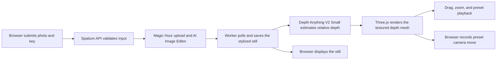

# Spatium technical architecture

Draft · 21 November 2026

## One-photo walkthrough revision

The default client submits to `POST /api/walkthroughs`. The worker stores the normalized source privately and creates three equirectangular panoramas, conditioning each later edit on the previous view and the source photo. Each active provider project is checkpointed before polling. Completed stops retain their project ID, charge and private asset. The browser interpolates between adjacent spherical views and lets users control heading and pitch. The player and 1280 × 720 WebM encoder share a ten-second route. The following depth pipeline continues to serve the separate miniature mode.

## Magic Hour tool choice

Use **AI Image Editor** (`POST /v1/ai-image-editor`) with one source photo and a prompt that changes materials and lighting while preserving scene layout. Use `gpt-image-2` at `1k`. It requires a paid Magic Hour tier and charged 100 credits per image in the gas-station comparison. It kept landmarks consistent across walkthrough stops where `flux-2-klein` (five credits) duplicated and altered them. Unlike `flux-2-klein`, it does not preserve the input aspect ratio, so the worker resizes each panorama to 2:1. The exact charge comes from the API response. [Magic Hour AI Image Editor API](https://docs.magichour.ai/api-reference/image-projects/ai-image-editor)

| Tool | Role in Spatium |
| --- | --- |
| AI Image Editor | Produces a restyled still that serves as the texture for the interactive scene. |
| AI Image Generator | Produces visuals from prompts. Spatium needs to preserve landmarks and framing from an uploaded photo. |
| Image-to-Video | Produces a pre-rendered clip from a still and a motion prompt. It could offer a cinematic export later. The MVP viewer and export use the same app-controlled camera path. |

Sources for tool behavior · [Magic Hour API overview](https://magichour.ai/api) · [Magic Hour Image-to-Video API](https://magichour.ai/api/image-to-video)

Prompt for the first prototype

> Restyle this exact photograph as a handcrafted tabletop miniature. Keep the original camera angle, framing, horizon, major objects, silhouettes, and foreground-to-background layout. Use painted clay and wood textures, fine model-scale details, soft studio lighting, and gentle shadows. Keep foreground and background edges legible. Avoid heavy blur, reframing, or adding objects.

Compare this prompt and baseline with `qwen-image-2.1` as a second free-tier candidate and `gpt-image-2` as a paid quality benchmark. Compare composition, depth artifacts, latency, and credits per accepted scene before changing the default. [Magic Hour AI Image Editor models](https://docs.magichour.ai/api-reference/image-projects/ai-image-editor)

## Request and rendering flow

### App and job processing

- Start with one same-origin deployment. FastAPI serves the built React/TypeScript frontend and the API. A bounded background worker runs provider polling and Python depth inference outside the request loop. SQLite stores job metadata and a private persistent volume holds the still and depth assets with a 24-hour TTL.
- `POST /api/scenes` receives the multipart file and the user's key via HTTPS and returns an opaque scene ID. Verify ownership with a signed session cookie. Decode with byte and pixel limits, apply EXIF orientation, strip metadata, and re-encode before upload. Show the source preview from a browser object URL.
- The worker requests one image upload via `POST /v1/files/upload-urls`, sends the normalized bytes with `PUT` to the signed URL, then calls `POST /v1/ai-image-editor` with `image_count: 1`, `model: "gpt-image-2"`, `resolution: "1k"`, `assets.image_file_paths`, and `style.prompt`. Store the returned image project ID and credits charged. [Magic Hour upload API](https://docs.magichour.ai/api-reference/files/generate-asset-upload-urls) · [Magic Hour AI Image Editor API](https://docs.magichour.ai/api-reference/image-projects/ai-image-editor)
- Poll `GET /v1/image-projects/{id}` with bounded backoff. On `complete`, fetch the download before its URL expires and serve the still from a session-authorized same-origin route. Treat `error` and `canceled` as terminal. The browser polls `GET /api/scenes/{id}` for job stage, credits, and available assets. [Magic Hour image project status](https://docs.magichour.ai/api-reference/image-projects/get-image-details)
- Use a client submission ID unique within the session and persist the start of the paid step before calling Magic Hour. Treat a lost creation response as an uncertain result and ask the user to check their Magic Hour project history before regenerating. Polling, asset fetches, and depth inference can retry without creating a new paid project.
- Keep the key in process memory until the still has been fetched or the provider processing window expires. Redact request bodies, credentials, and signed URLs from logs. If the process restarts with a known provider project ID, let the user re-enter the key to resume polling that project. If the still already exists, resume at depth without a key. Expire job rows and assets together, and rate-limit submissions and the worker queue.

### Depth and camera

1. Run **Depth Anything V2 Small** on the stylized still so depth aligns with its visible edges. The Small checkpoint supplies relative depth and is published under Apache 2.0. Preserve aspect ratio during preprocessing and map the output back into the still's coordinate system. [Depth Anything V2](https://github.com/DepthAnything/Depth-Anything-V2)
2. Clamp outliers by percentile and map model output into a bounded positive camera-depth range, verifying that near pixels end up closer to the camera. Package the result as a normalized 16-bit depth buffer with dimensions and version in a scene manifest. The same manifest supplies the image URL, source aspect ratio, and camera parameters.
3. In Three.js, project a sampled image grid along rays from the reference perspective camera using the depth buffer. Texture the mesh using the original pixel UVs so the reset pose reproduces the stylized still. Lateral camera translation creates parallax. Add a bounded dolly for zoom and keep all movement near the reference view. [Three.js scene and camera setup](https://threejs.org/manual/pages/creating-a-scene.html)
4. Limit triangle stretch near sharp depth changes. If dropping triangles across those edges exposes holes, use a conservative background fill and constrain lateral travel. Tune movement against the challenging photos, where thin or overlapping objects reveal missing background pixels earliest. Use the still for flat depth results or unavailable WebGL 2. [Three.js WebGLRenderer](https://threejs.org/docs/pages/WebGLRenderer)

### Video export

Render the preset camera sweep into a separate export canvas at the scene aspect ratio. Encode 180 frames with explicit 30 fps timestamps using WebCodecs and Mediabunny to produce a six-second WebM regardless of render speed. Cap the short edge at 720 px and the long edge at 1280 px without upscaling. Check VP8 support at runtime and serve textures from the same origin. [Mediabunny CanvasSource](https://mediabunny.dev/api/CanvasSource)

## Implementation

Follow the [implementation plan](implementation-plan.md) for the ordered work, test gates, and completion records.

See [product requirements](prd.md) for the MVP scope and acceptance criteria.
