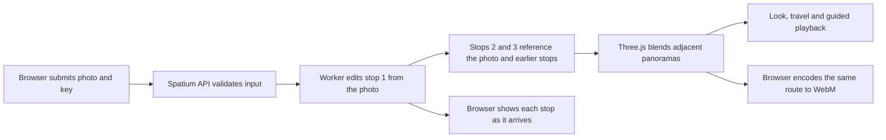

# Spatium technical architecture

Draft · 21 November 2026

## Magic Hour tool choice

Use **AI Image Editor** (`POST /v1/ai-image-editor`) with the source photo and earlier stops as references and a prompt that asks for an equirectangular miniature environment. Use `gpt-image-2` at `1k`. It requires a paid Magic Hour tier and charged 100 credits per image in the gas-station comparison. It kept landmarks consistent across walkthrough stops where `flux-2-klein` (five credits) duplicated and altered them. It does not preserve the input aspect ratio, so the worker resizes each panorama to 2:1. The exact charge comes from the API response. [Magic Hour AI Image Editor API](https://docs.magichour.ai/api-reference/image-projects/ai-image-editor)

| Tool | Role in Spatium |
| --- | --- |
| AI Image Editor | Produces each stop's panorama from the source photo and earlier stops. |
| AI Image Generator | Produces visuals from prompts alone. Spatium needs landmarks from an uploaded photo. |
| Image-to-Video | Produces a pre-rendered clip from a still. It could offer a cinematic export later. The viewer and export share an app-controlled route instead. |

Sources for tool behavior · [Magic Hour API overview](https://magichour.ai/api) · [Magic Hour Image-to-Video API](https://magichour.ai/api/image-to-video)

## Request and rendering flow

### App and job processing

- One same-origin deployment. FastAPI serves the built React and TypeScript frontend and the API. A single background task runs the provider calls outside the request loop. SQLite stores scene metadata, and a private persistent volume holds the source and stop images with a 24-hour TTL. The free hosted configuration keeps the same origin through a Vercel rewrite to one Render process, stores metadata in Supabase Postgres and images in a private Cloudflare R2 bucket, and reads the cookie signing secret from `SPATIUM_SESSION_SECRET`.
- `POST /api/walkthroughs` receives the multipart file and the user's key over HTTPS and returns an opaque scene ID. Verify ownership with a signed session cookie. Decode with byte and pixel limits, apply EXIF orientation, strip metadata and re-encode before storing the source privately.
- For each stop, the worker requests upload URLs via `POST /v1/files/upload-urls`, sends the guide and reference images with `PUT`, then calls `POST /v1/ai-image-editor` with `image_count: 1`, `model: "gpt-image-2"`, `resolution: "1k"`, `assets.image_file_paths` and `style.prompt`. Stop 1 uses the photo padded to 2:1. Later stops use the previous panorama as the guide, with the photo and every earlier stop as references. The far stop is generated facing back toward the start and rotated half a turn so all three stops share one heading. [Magic Hour upload API](https://docs.magichour.ai/api-reference/files/generate-asset-upload-urls)
- Poll `GET /v1/image-projects/{id}` with bounded backoff. On `complete`, fetch the download before its URL expires and serve it from a session-authorized same-origin route. Treat `error` and `canceled` as terminal. The browser polls `GET /api/scenes/{id}` for stage, credits and available stops. [Magic Hour image project status](https://docs.magichour.ai/api-reference/image-projects/get-image-details)
- Use a client submission ID unique within the session and persist the start of each paid step before calling Magic Hour. Checkpoint each project ID before polling. Treat a lost creation response as an uncertain result and ask the user to check their Magic Hour project history before regenerating.
- Keep the key in process memory only while stops are generating. Redact request bodies, credentials and signed URLs from logs. After a restart or provider delay, completed stops remain viewable, and `POST /api/scenes/{id}/resume` with the key resumes a known project or creates only the missing stops. Expire rows and assets together, and rate-limit submissions and the worker.

### Panorama viewer

The browser loads each stop as an equirectangular texture. A full-screen shader casts a ray per pixel from the camera heading and pitch. While travelling between stops, it projects the outgoing and incoming panoramas from their own capture centers and cross-fades them, which gives a short sense of forward motion. At a stop, the texture is sampled exactly at its center. Mipmaps are disabled to avoid a visible seam at the wraparound.

### Video export

Render the guided route into a separate 1280 × 720 canvas. Encode 300 frames with explicit 30 fps timestamps using WebCodecs and Mediabunny to produce a ten-second VP8 WebM regardless of render speed. Check VP8 support at runtime and serve textures from the same origin. [Mediabunny CanvasSource](https://mediabunny.dev/api/CanvasSource)

## Implementation

Follow the [implementation plan](implementation-plan.md) for the ordered work, test gates and completion records.

See [product requirements](prd.md) for the scope and acceptance criteria.
